# Diagrama de Flujo y Documentación Técnica - Guía 3
**Asignatura:** Aplicaciones y servicios web  
**Institución:** Institución Universitaria ITM  
**Docente:** Jonathan Sánchez Giraldo  

---

## 1. Diagrama de Flujo del Proceso Completo

Este diagrama modela el ciclo de vida completo de la solución solicitada en la Guía 3: desde el inicio de sesión del usuario en Auth0 hasta la modificación de sus datos personales y la persistencia en `user_metadata` mediante la Auth0 Management API v2.

```mermaid
flowchart TD
    Start(["Inicio: Usuario accede a http://localhost:3000"]) --> CheckAuth{"¿Está autenticado el usuario?"}
    
    CheckAuth -- No --> BtnLogin["Muestra botón 'Iniciar Sesión con Auth0'"]
    BtnLogin --> ClickLogin["Usuario hace clic en Iniciar Sesión"]
    ClickLogin --> RedirectAuth0["Redirección al Universal Login de Auth0 (Personalizado con logo y colores ITM)"]
    RedirectAuth0 --> AuthProcess["Usuario ingresa credenciales en Auth0"]
    AuthProcess --> Callback["Auth0 redirige a http://localhost:3000/callback con código de autorización"]
    Callback --> SessionCreated["express-openid-connect intercambia código por tokens y crea cookie de sesión"]
    SessionCreated --> HomeAuth["Redirección a Home en estado: Autenticado"]

    CheckAuth -- Sí --> HomeAuth
    HomeAuth --> GoProfile["Usuario ingresa a 'Modificar Datos' (/perfil)"]
    
    GoProfile --> ReqProfile["Petición GET /perfil al servidor Node.js"]
    ReqProfile --> GetUserSub["Servidor extrae ID del usuario (req.oidc.user.sub)"]
    GetUserSub --> M2MToken1["Node.js solicita/usa Token M2M hacia Auth0 Management API"]
    M2MToken1 --> CallGetAPI["GET https://{tenant}.us.auth0.com/api/v2/users/{id}"]
    CallGetAPI --> CheckMeta{"¿Tiene datos en user_metadata?"}
    
    CheckMeta -- No / Vacío --> RenderEmpty["Renderiza formulario con campos vacíos (documento, dirección, teléfono)"]
    CheckMeta -- Sí --> RenderFilled["Renderiza formulario prellenado con datos de user_metadata"]
    
    RenderEmpty --> EditForm["Usuario diligencia / edita los 4 campos obligatorios"]
    RenderFilled --> EditForm
    
    EditForm --> SubmitForm["Usuario presiona 'Guardar en user_metadata' (POST /perfil)"]
    SubmitForm --> ServerPost["Servidor Express recibe datos en el cuerpo de la petición"]
    ServerPost --> M2MToken2["ManagementClient prepara payload con los nuevos valores"]
    M2MToken2 --> CallPatchAPI["PATCH https://{tenant}.us.auth0.com/api/v2/users/{id} (user_metadata)"]
    CallPatchAPI --> Auth0Update["Auth0 actualiza el documento del usuario en la nube"]
    Auth0Update --> RespSuccess["Auth0 responde 200 OK con el usuario actualizado"]
    RespSuccess --> RedirectSuccess["Servidor redirige a /perfil?actualizado=true"]
    RedirectSuccess --> ShowSuccess["Muestra alerta de éxito y datos sincronizados en tiempo real"]
    ShowSuccess --> End(["Fin del flujo"])
```

---

## 2. Explicación Paso a Paso del Desarrollo (Redacción para el Informe)

### Paso 1: Configuración del formulario de logueo de Auth0
* Se creó una aplicación web en el entorno de **Node.js** utilizando el framework **Express**.
* Se integró la librería oficial `express-openid-connect`, la cual gestiona de manera transparente y segura el flujo de autorización OpenID Connect / OAuth 2.0 (Authorization Code Flow).
* Se definió un middleware con la configuración del tenant (`issuerBaseURL`), el identificador de cliente (`clientID`), el secreto de cliente (`clientSecret`), el secreto para cifrar la cookie de sesión (`secret`) y la URL base local (`baseURL: http://localhost:3000`).
* La aplicación ofrece rutas públicas para la presentación del proyecto y rutas protegidas con el middleware `requiresAuth()` para garantizar que únicamente los usuarios con sesión activa puedan interactuar con la gestión de información personal.

### Paso 2: Personalización del Universal Login de Auth0
* Desde la consola administrativa de Auth0 (*Branding > Universal Login > Advanced Options / Customization*), se configuró la pantalla de autenticación centralizada.
* Se incorporó el logotipo oficial de la **Institución Universitaria ITM**, se ajustó la paleta cromática a los colores corporativos (azul institucional `#003865` y acentos contrastantes) y se personalizó el texto del formulario de ingreso.
* Con esto, al redirigir al usuario local hacia `https://{tenant}.us.auth0.com/authorize`, el usuario experimenta una interfaz con identidad visual académica uniforme y confiable.

### Paso 3: Espacio para modificar los datos del usuario
* Se construyó una vista dinámica utilizando el motor de plantillas **EJS** y **Bootstrap 5.3** en la ruta `/perfil`.
* El formulario contiene rigurosamente los cuatro campos solicitados:
  1. **Tipo de documento:** Selector desplegable (Cédula de Ciudadanía, Tarjeta de Identidad, Cédula de Extranjería, Pasaporte).
  2. **Número de documento:** Entrada numérica/alfanumérica para el identificador legal.
  3. **Dirección:** Entrada de texto con la dirección residencial del estudiante/usuario.
  4. **Teléfono:** Entrada telefónica de contacto.
* El formulario implementa la lectura reactiva: cuando la ruta es invocada, el servidor consulta la API de Auth0 para extraer el estado actual del objeto `user_metadata`. Si existen valores previos, los campos se prellenan automáticamente en el HTML (`value="<%= metadata.campo %>"`). Si el usuario es nuevo, los campos se despliegan limpios listos para su diligenciamiento.

### Paso 4: Consumo de la Management API de Auth0 para guardar los datos
* Para modificar los datos del usuario directamente en los servidores de Auth0, se utilizó la **Management API v2** (`PATCH /api/v2/users/{id}`).
* La autenticación entre el servidor Node.js y la Management API se realizó mediante una aplicación **Machine-to-Machine (M2M)** en Auth0, autorizada con los alcances (*scopes*) `read:users` y `update:users`.
* A través del SDK oficial `auth0` (`ManagementClient`), se envían los datos validados del formulario.
* Una vez procesada la solicitud en Auth0, la respuesta confirma la actualización y la interfaz local muestra una alerta de confirmación junto con un visor en tiempo real del JSON de `user_metadata` devuelto por el servicio en la nube.

---

## 3. Checklist de Evidencias Requeridas para el PDF

1. **Evidencia 1 (Punto 1):** Captura de pantalla de la aplicación corriendo en `http://localhost:3000` con el botón de "Iniciar sesión con Auth0" y el estado de sesión local.
2. **Evidencia 2 (Punto 2):** Captura de pantalla del **Universal Login** de Auth0 mostrando el logo y diseño personalizado del ITM.
3. **Evidencia 3 (Punto 3):** Captura de pantalla del formulario en `/perfil` corriendo en local, mostrando los 4 campos y cómo se prellenan con los datos.
4. **Evidencia 4 (Punto 4):** Captura de pantalla del código en `server.js` donde se invoca `management.users.update` y captura del resultado en la app local (y opcionalmente en el Dashboard de Auth0 en *User Management > Users > user_metadata*).
5. **Evidencia 5 (Punto 5):** Captura del repositorio en GitHub donde se evidencie la invitación al docente `jonathansanchez2948@correo.itm.edu.co` como colaborador.

---

## 4. Bibliografía

* Auth0 by Okta. (2024). *Auth0 Express OpenID Connect SDK Documentation*. Recuperado de: https://github.com/auth0/express-openid-connect
* Auth0 by Okta. (2024). *Auth0 Management API v2 Reference: Update a user*. Recuperado de: https://auth0.com/docs/api/management/v2#!/Users/patch_users_by_id
* Auth0 by Okta. (2024). *Understand How Metadata Works in User Profiles*. Recuperado de: https://auth0.com/docs/manage-users/user-accounts/metadata
* Express.js. (2024). *Fast, unopinionated, minimalist web framework for Node.js*. Recuperado de: https://expressjs.com/
* Institución Universitaria ITM. (2024). *Manual de Identidad Visual Institucional*. Medellín, Colombia.
